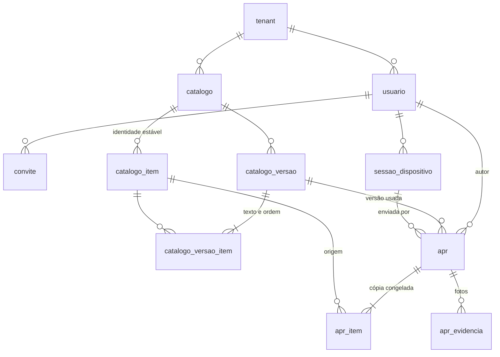

# Banco de dados — CampoSeguro

Modelo físico do PostgreSQL compartilhado pelas três aplicações. O porquê das decisões de produto está no `ARQUITETURA.md`; aqui fica o que o banco garante e como evoluí-lo.

Código: entidades em `CampoSeguro.Domain`, mapeamento e migrations em `CampoSeguro.Data`, aplicação das migrations em `CampoSeguro.Migrator`.

## Diagrama



`administrador_plataforma` fica fora do diagrama porque não se relaciona com nada: é a equipe CampoSeguro, sem tenant.

## Convenções

- **Nomes:** classes em PascalCase no C#, tabelas e colunas em `snake_case` e no singular (`apr`, `catalogo_versao`, `tenant_id`). Chaves estrangeiras seguem `fk_<tabela>_<relação>` (ex.: `fk_apr_autor`).
- **Ids:** `uuid`. O padrão é GUID v7, ordenável no tempo e por isso gentil com os índices. `apr.id` e `apr_evidencia.id` **vêm do celular**, e o banco nunca os gera: é isso que permite criar a APR offline e torna o reenvio idempotente.
- **Datas:** `timestamptz`, gravadas sempre em UTC. O `DbContext` converte o horário local que vem do aparelho (-03:00).
- **Enums:** gravados como texto (`'NaoConforme'`, `'Tecnico'`), legíveis em SQL manual e imunes a reordenação no código.
- **Hashes:** `bytea` de 32 bytes (SHA-256), com o tamanho conferido por `CHECK`.
- **Auditoria:** toda tabela tem `criado_em` e `criado_por`, preenchidos pelo `DbContext`.
- **Exclusão:** toda FK é `RESTRICT`. Nada é apagado em cascata.

## Isolamento entre empresas

Toda tabela de negócio tem `tenant_id`. O isolamento é garantido em três camadas, para que um descuido em uma delas não baste para vazar dados:

1. **Filtro global no EF Core.** As consultas só enxergam o tenant do `IContextoTenant`, que cada backend preenche **a partir do JWT**. Sem tenant no contexto, nenhuma linha é devolvida. O modelo se recusa a montar se uma entidade de tenant ficar sem filtro.
2. **Gravação conferida.** No `SaveChanges`, um registro novo herda o tenant do contexto. Um registro com outro tenant é recusado, e o `tenant_id` de um registro existente não pode ser alterado.
3. **Chaves estrangeiras compostas.** Toda relação entre tabelas de negócio é `(tenant_id, x_id) → (tenant_id, id)`. Assim o próprio banco impede, por exemplo, uma APR da empresa B que aponte para o catálogo da empresa A, mesmo que o celular envie um GUID forjado.

`IgnoreQueryFilters()` só pode aparecer em dois lugares: na **Plataforma**, que enxerga todos os tenants, e na **busca de login** (por e-mail ou pelo hash do token), que acontece antes de se saber o tenant. Em qualquer outro lugar, é bug.

## Tabelas

### Identidade

| Tabela | Papel | Regras no banco |
|---|---|---|
| `tenant` | Empresa-cliente | `documento` é um CNPJ de 14 dígitos, sem máscara, e único |
| `administrador_plataforma` | Equipe CampoSeguro | e-mail único. Fica fora de `usuario` para que `usuario.tenant_id` nunca seja nulo, condição para as chaves compostas |
| `usuario` | Gestor ou técnico | e-mail único **só entre ativos**, em todos os tenants (índice parcial); desativar exige `desativado_em`; anonimizar exige estar inativo; `senha_hash` nulo até aceitar o convite |
| `convite` | Link de primeiro acesso ou de redefinição de senha | só o hash do token; no máximo **um pendente** por usuário e tipo, então reenviar exige revogar o anterior; `expira_em > criado_em` |
| `sessao_dispositivo` | Refresh token por aparelho | só o hash; `revogada_em` corta o acesso de um colaborador desativado mesmo com o token ainda válido |

### Catálogo

O catálogo é a atividade. "Telecom — Altura" e "Telecom — Mesmo Nível" são dois catálogos, e por isso a APR não tem um campo "tipo" que poderia divergir dele.

| Tabela | Papel |
|---|---|
| `catalogo` | Nome único por tenant. Ao ser desativado, some do app |
| `catalogo_item` | **Identidade** de um item ao longo das versões, sem texto. É por ela que o indicador "itens mais não conformes" agrupa, mesmo depois de o texto ser corrigido |
| `catalogo_versao` | Retrato numerado (1, 2, 3…). `publicada_em` nulo indica rascunho; preenchido, a versão está congelada |
| `catalogo_versao_item` | Texto e ordem do item naquela versão |

**Ciclo de vida:** o gestor edita um rascunho (há no máximo um por catálogo) e publica. Uma versão publicada nunca muda e é o que o app baixa. A próxima edição abre o rascunho N+1. Itens nunca são excluídos: deixam de aparecer simplesmente não entrando na versão nova.

### APR

| Tabela | Papel |
|---|---|
| `apr` | APR **já assinada**: o rascunho vive só no SQLite do aparelho. Guarda autor, nome do autor congelado, versão do catálogo, `assinada_em` (relógio do aparelho), `recebida_em` (servidor), hash do conteúdo, local (GPS opcional + descrição) e o PDF, que chega depois |
| `apr_item` | Cópia congelada de cada item: texto, ordem, `resposta` (`Conforme`, `NaoConforme`, `NaoAplica`) e observação, além do `catalogo_item_id` de origem |
| `apr_evidencia` | Foto. O registro chega junto com a APR (id, hash, dimensões) e o arquivo sobe depois, preenchendo `caminho` e `recebida_em`. Quando a política de retenção apaga o arquivo, preenche `expurgada_em` e mantém o registro e o hash |

O nome do autor é copiado para `apr.autor_nome` porque a anonimização LGPD sobrescreve `usuario.nome`, e o documento de segurança precisa continuar dizendo quem o assinou.

## Imutabilidade (triggers)

O EF não modela triggers, por isso eles ficam na migration `Imutabilidade`, escrita à mão. **Ao regerar a `Inicial`, preserve esse arquivo.**

| Tabela | O banco recusa |
|---|---|
| `apr` | excluir; alterar qualquer coluna exceto anexar o PDF, o que só pode ser feito uma vez; inserir APR com versão de catálogo **não publicada** |
| `apr_item` | alterar ou excluir; inserir item que não pertença à versão da APR ou cujo texto **difira** do texto da versão |
| `apr_evidencia` | excluir; alterar a identificação (hash, dimensões, APR) |
| `catalogo_versao` | alterar ou excluir uma versão publicada; publicar uma versão sem itens |
| `catalogo_versao_item` | incluir, alterar ou excluir itens de uma versão publicada |

Os erros usam `SQLSTATE` `23001` (`restrict_violation`) ou `23514` (`check_violation`), para que a API os traduza em 409/422.

## Migrations

O SDK fica fora do PATH (ver `CLAUDE.md`). O `dotnet-ef` está fixado no manifesto local `dotnet-tools.json`; rode `dotnet tool restore` uma vez.

```powershell
$env:PATH = "$env:LOCALAPPDATA\Microsoft\dotnet;$env:PATH"
$env:DOTNET_ROOT = "$env:LOCALAPPDATA\Microsoft\dotnet"

# Nova migration depois de mudar entidade ou configuração (não precisa de banco)
dotnet ef migrations add <Nome> -p CampoSeguro.Data -o Migracoes

# Conferir o SQL antes de aplicar
dotnet ef migrations script -p CampoSeguro.Data -o migracao.sql

# Aplicar: sempre pelo Migrator, nunca pelos backends
$env:CAMPOSEGURO_DB = "Host=localhost;Database=camposeguro;Username=...;Password=..."
dotnet run --project CampoSeguro.Migrator -- --listar   # só mostra as pendentes
dotnet run --project CampoSeguro.Migrator
```

A tabela de controle é `ef_historico_migracoes`.

## Limitações conhecidas

- **Itens da APR depois da assinatura:** o banco não impede incluir um `apr_item` numa APR já recebida. A API deve gravar a APR e todos os itens numa única transação e recusar inclusões posteriores.
- **Consistência entre versão e catálogo:** o banco não confere se o `catalogo_item` de uma versão pertence ao mesmo `catalogo`; a API do Painel garante isso.
- **Unicidade de e-mail:** com e-mail único entre ativos, um técnico não pode estar ativo em duas empresas ao mesmo tempo. A decisão foi tomada em 2026-10-15 e mudá-la exige separar pessoa e vínculo.
